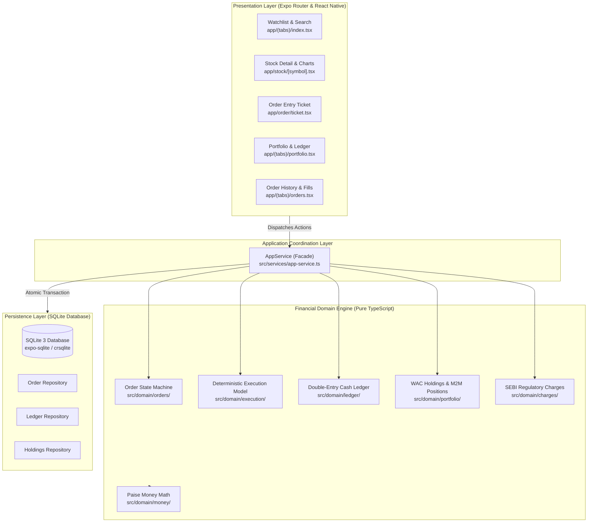

# MarketMimic

> A personal Indian stock market paper-trading simulator with a native Android app, deterministic trading engine, persistent portfolio ledger, and local-first architecture.

[](https://developer.android.com)
[](https://reactnative.dev)
[](https://expo.dev)
[](https://www.typescriptlang.org)
[](https://vitest.dev)
[](https://github.com/Rayhan-099/MarketMimic/releases/tag/v1.0.0)

---

> [!IMPORTANT]
> **Educational & Simulation Disclaimer:**  
> MarketMimic is an educational simulation tool for personal research and paper trading. It is **not** a registered stockbroker, financial intermediary, or investment adviser under SEBI regulations. It **does not execute trades on real financial exchanges** (NSE, BSE, or MCX) and handles **zero real capital**. All quotes and historical ticks are simulated or historical demo datasets.

---

## Table of Contents

- [Overview](#overview)
- [Screenshots & Visual Showcase](#screenshots--visual-showcase)
- [Features](#features)
- [Architecture & Data Flow](#architecture--data-flow)
- [Financial Calculation Engine](#financial-calculation-engine)
- [Technology Stack](#technology-stack)
- [Repository Structure](#repository-structure)
- [Android Release APK Download](#android-release-apk-download)
- [Installation Instructions](#installation-instructions)
- [Development Setup](#development-setup)
- [Testing & Verification Gates](#testing--verification-gates)
- [Limitations & Roadmap](#limitations--roadmap)
- [Security & Privacy](#security--privacy)
- [License & Credits](#license--credits)

---

## Overview

**MarketMimic** brings institutional rigor to personal retail trading practice in the Indian equity ecosystem. Many paper-trading apps rely on loose floating-point math, unvalidated order tickets, or opaque third-party cloud backends.

MarketMimic takes a **local-first, deterministic, double-entry financial accounting approach**:
- **Integer Paise Representation:** Every monetary amount (cash, margins, order values, taxes, and fees) is tracked exclusively in integer paise (1 Rupee = 100 paise), eliminating floating-point rounding errors.
- **Double-Entry Cash Ledger:** Cash balance cannot increase or decrease without balancing debit/credit journal entries.
- **Delivery & Intraday Invariants:** Strict separation between delivery trades (Cash-and-Carry / CNC using Weighted Average Cost) and intraday trades (Margin Intraday Square-off / MIS with real-time Mark-to-Market tracking).
- **SEBI/Exchange Regulatory Tax Engine:** Accurate pre-trade calculation of Securities Transaction Tax (STT), Exchange Turnover Charges, SEBI Turnover Fees, Stamp Duty, and GST (18%).
- **Completely Zero-Cost & Offline-First:** Runs 100% locally on Android with an embedded SQLite database and Hermes bytecode. No cloud build services, subscriptions, or paid API keys required.

---

## Screenshots & Visual Showcase

> [!NOTE]
> *Screenshots Placeholder: Actual physical application screenshots will be captured and added following hands-on device testing. The layout below illustrates the verified screen hierarchy.*

| Screen | Route | Description |
|---|---|---|
| **Watchlist & Dashboard** | `app/(tabs)/index.tsx` | Nifty 50 / Sensex overview, stock quotes, percent change, mini trend sparklines |
| **Stock Details** | `app/stock/[symbol].tsx` | Price depth, high/low/volume stats, interactive candlestick/area charts |
| **Order Ticket** | `app/order/ticket.tsx` | Delivery (CNC) vs Intraday (MIS), Market/Limit switch, dynamic margin validation, SEBI fee breakdown |
| **Order Book** | `app/(tabs)/orders.tsx` | Open orders, executed trades, cancellations, and rejection audit logs |
| **Portfolio & Holdings** | `app/(tabs)/portfolio.tsx` | Total portfolio valuation, day P&L, overall P&L, WAC delivery holdings, M2M intraday positions |
| **Replay & Settings** | `app/(tabs)/settings.tsx` | Simulation tick replay controls, speed slider (1x–10x), local database reset |

---

## Features

### 1. Watchlist & Discovery
- Fast stock search across Indian equities (e.g., RELIANCE, TCS, INFY, HDFCBANK, ICICIBANK).
- Filter by exchange (NSE / BSE), market cap, and performance.
- Real-time quote cards with color-coded directional metrics (`#00D09C` gain, `#EB5B3C` loss).

### 2. Deep Stock Analysis
- High, low, open, close (OHLC), volume, and 52-week statistics.
- Interactive timeframe toggles (1D, 1W, 1M, 1Y, ALL).
- Native chart canvas rendering responsive candlestick and smooth area curves.

### 3. Institutional Order Execution
- **Product Types:** CNC (Cash & Carry / Delivery) and MIS (Margin Intraday Square-off).
- **Order Types:** Market and Limit orders with tick-size validation (₹0.05 multiples).
- **Margin & Capital Safeguards:** Orders are rejected immediately if required funds (including regulatory charges) exceed available cash.
- **SEBI Regulatory Charges Preview:** Itemized STT, GST, SEBI fee, Stamp duty, and Exchange charge estimation prior to order submission.

### 4. Portfolio, Holdings & Intraday Positions
- **Delivery Holdings (CNC):** Realized P&L and unrealized P&L calculated via strictly tested Weighted Average Cost (WAC) formulas.
- **Intraday Positions (MIS):** Net quantity, average buy/sell prices, and real-time Mark-to-Market (M2M) P&L.
- **Cash Ledger:** Ledger balance, available trading margin, and funds utilized summary.

### 5. Historical Tick Replay
- Deterministic tick-by-tick simulation coordinator.
- Play, pause, step forward, and configurable replay speed (1x, 2x, 5x, 10x).
- Limit order triggers fire precisely when simulated market prices breach limit thresholds.

### 6. Local-First SQLite Persistence
- Embedded SQLite via `expo-sqlite` and `crsqlite`.
- ACID transaction boundaries ensure order state, ledger transactions, and holdings update atomically.
- Zero data leaves your device.

---

## Architecture & Data Flow



### Order Execution Lifecycle

1. **Validation:** User enters order on `OrderTicket`. `validateOrder()` checks quantity (`> 0`), limit price tick alignment (multiples of 5 paise), and available cash balance including SEBI charges.
2. **Reservation / Lock:** Available cash is atomically earmarked in the cash ledger.
3. **Execution Match:** `ExecutionEngine` evaluates current market bid/ask against order parameters.
4. **Journaling:** A double-entry ledger entry is booked (Cash Account credited, Stock Holding / Intraday Asset debited, Regulatory Expense debited).
5. **Portfolio Update:** Delivery positions recalculate WAC (`(old_qty * old_wac + new_qty * price) / total_qty`); Intraday positions adjust net quantity and M2M baseline.
6. **Persistence:** All updates are committed inside a single SQLite transaction.

---

## Financial Calculation Engine

### 1. Integer Arithmetic (Zero Float Invariant)
All monetary values in MarketMimic are stored and computed in integer paise:
$$\text{paise} = \text{round}(\text{rupees} \times 100)$$

Multiplication and division operations use integer rounding routines (`roundPaise`, `multiplyPaise`) to prevent cumulative IEEE-754 floating-point drift.

### 2. Weighted Average Cost (WAC)
When adding to a delivery holding:
$$\text{WAC}_{\text{new}} = \left\lfloor \frac{(\text{Qty}_{\text{existing}} \times \text{WAC}_{\text{existing}}) + (\text{Qty}_{\text{new}} \times \text{Price}_{\text{buy}})}{\text{Qty}_{\text{existing}} + \text{Qty}_{\text{new}}} \right\rfloor$$

When selling from a delivery holding, WAC remains constant, and realized P&L is realized:
$$\text{Realized P\&L} = \text{Qty}_{\text{sold}} \times (\text{Price}_{\text{sell}} - \text{WAC}_{\text{existing}}) - \text{Charges}$$

### 3. Regulatory Charges Model (SEBI Schedule)

| Charge | Delivery (CNC) | Intraday (MIS) |
|---|---|---|
| **Brokerage** | ₹0 (Zero brokerage simulator) | ₹0 |
| **STT / CTT** | 0.1% on Buy & Sell | 0.025% on Sell only |
| **Exchange Turnover** | 0.00297% (NSE rate) | 0.00297% (NSE rate) |
| **SEBI Turnover Fee** | ₹10 per crore (0.0001%) | ₹10 per crore (0.0001%) |
| **Stamp Duty** | 0.015% on Buy | 0.003% on Buy |
| **GST** | 18% on (Exchange + SEBI fees) | 18% on (Exchange + SEBI fees) |

---

## Technology Stack

| Layer | Technology | Version | Purpose |
|---|---|---|---|
| **Framework** | React Native | `0.76.7` | Native Android mobile application runtime |
| **App Platform** | Expo | `52.0.49` | Application configuration and native modules |
| **Routing** | Expo Router | `4.0.22` | File-system-based typed application navigation |
| **Language** | TypeScript | `5.7.2` | Strict static typing (`exactOptionalPropertyTypes: true`) |
| **Database** | SQLite / Expo SQLite | `15.1.3` | Local persistent relational database |
| **Native CRDT** | CR-SQLite | Custom NDK | Offline-first conflict-free SQLite extension |
| **JS Engine** | Hermes Bytecode | Embedded | High-performance mobile JS engine with precompiled bytecode |
| **Testing** | Vitest | `2.1.8` | Financial engine unit, integration, and invariant test suite |
| **Native Toolchain** | Android Gradle Plugin / NDK | `8.7.2` / `26.1` | Native Android release build toolchain |

---

## Repository Structure

```
MarketMimic/
├── app/                          # Expo Router application screens & navigation
│   ├── (tabs)/                   # Bottom tab navigator
│   │   ├── index.tsx             # Watchlist & market overview screen
│   │   ├── portfolio.tsx         # Holdings, positions & ledger screen
│   │   ├── orders.tsx            # Order book & trade history screen
│   │   ├── search.tsx            # Stock search & discovery screen
│   │   ├── settings.tsx          # Replay settings & app configuration
│   │   └── _layout.tsx           # Tab bar styling & layout
│   ├── order/                    # Order entry modal flow
│   │   ├── ticket.tsx            # Buy/sell order entry ticket
│   │   └── confirm.tsx           # Order confirmation & fee breakdown
│   ├── stock/
│   │   └── [symbol].tsx          # Dynamic stock detail & chart screen
│   └── _layout.tsx               # Root app layout, providers & safe-area
├── assets/                       # App icons, adaptive icons & splash screens
├── docs/                         # Architecture, design & verification records
│   ├── architecture/             # Decision logs & domain contracts
│   ├── implementation/           # Release manifests, logs & verification reports
│   └── research/                 # Clean-room observation & UX evidence logs
├── src/                          # Application source code
│   ├── components/               # Modular UI components (charts, inputs, cards)
│   ├── domain/                   # Pure financial engine (zero UI/framework dependencies)
│   │   ├── charges/              # SEBI tax & fee calculation rules
│   │   ├── execution/            # Deterministic order matching & execution engine
│   │   ├── ledger/               # Double-entry cash accounting ledger
│   │   ├── market/               # Market data contracts & ticker models
│   │   ├── money/                # Integer paise arithmetic & formatting
│   │   ├── orders/               # Order state machine & validation rules
│   │   ├── portfolio/            # WAC holdings & M2M position calculators
│   │   └── replay/               # Deterministic historical tick replay coordinator
│   ├── services/                 # Application facade & orchestrators
│   ├── storage/                  # SQLite repositories, schemas & migrations
│   └── theme/                    # Design tokens (colors, typography, spacing, shadows)
├── tests/                        # Automated test suites (133 tests)
│   ├── components/               # UI component behavioral tests
│   ├── domain/                   # Financial calculation engine unit tests
│   ├── invariants/               # Long-run financial integrity & invariant tests
│   ├── services/                 # AppService integration tests
│   ├── storage/                  # SQLite transactional tests
│   └── theme/                    # Design token validation tests
├── android/                      # Native Android project (Gradle, CMake, C++)
├── app.json                      # Expo application manifest
├── babel.config.js               # Babel configuration
├── metro.config.cjs              # Metro bundler configuration
├── package.json                  # Dependencies & build scripts
├── tsconfig.json                 # TypeScript strict compiler configuration
└── vitest.config.ts              # Vitest test runner configuration
```

---

## Android Release APK Download

The standalone release APK was compiled locally using OpenJDK 17 and Android SDK 35 without third-party cloud build services:

| Specification | Value |
|---|---|
| **Release Tag** | [`v1.0.0`](https://github.com/Rayhan-099/MarketMimic/releases/tag/v1.0.0) |
| **Download Asset** | [`MarketMimic-release.apk`](https://github.com/Rayhan-099/MarketMimic/releases/download/v1.0.0/MarketMimic-release.apk) |
| **Package ID** | `com.marketmimic.app` |
| **Version** | `1.0.0` (Version Code `1`) |
| **Exact File Size** | `80,143,152 bytes` (76.43 MB) |
| **SHA-256 Checksum** | `d1ba172f3cabc61d7fbfbc91a80cd6830abb609f6f0bd4e431f50b18cdd09300` |
| **Android Compatibility** | Android 7.0+ (Min SDK 24, Target SDK 34, Compile SDK 35) |
| **Supported ABIs** | `arm64-v8a`, `armeabi-v7a`, `x86`, `x86_64` (Universal APK) |
| **Bytecode Format** | Hermes Bytecode (`c6 1f bc 03` header confirmed) |

---

## Installation Instructions

### Option 1: Direct Phone Sideloading (Recommended)

1. Download [`MarketMimic-release.apk`](https://github.com/Rayhan-099/MarketMimic/releases/download/v1.0.0/MarketMimic-release.apk) directly on your Android device (or transfer it from your PC).
2. Open the downloaded file using your device's **Files / Downloads** app.
3. If prompted with *"For your security, your phone is not allowed to install unknown apps from this source"*:
   - Tap **Settings**.
   - Enable **Allow from this source**.
4. Tap **Install** and launch **MarketMimic**.

### Option 2: Sideload via Android Debug Bridge (`adb`)

For developers with an Android device connected via USB with USB Debugging enabled:

```bash
# 1. Verify your device is recognized
adb devices

# 2. Install the standalone APK
adb install -r MarketMimic-release.apk

# 3. Launch the application
adb shell am start -n com.marketmimic.app/.MainActivity
```

> [!NOTE]
> **Physical Device Audit Disclosure:**  
> The release APK has been compiled, aligned, and verified structurally on disk with `aapt`. Physical-device installation and interactive on-screen smoke testing remain unverified on hardware as no physical handset was connected during the build verification phase.

---

## Development Setup

### Prerequisites

- **Node.js:** v18.0.0+ (Tested on Node v20/v26)
- **npm:** v9.0.0+
- **Java Development Kit:** OpenJDK 17 LTS (Required for local native Android builds)
- **Android SDK:** Platforms 34/35, Build-tools 35.0.0, NDK 26.1 (For native release builds)

### 1. Clone & Install Dependencies

```bash
git clone https://github.com/Rayhan-099/MarketMimic.git
cd MarketMimic

# Install exact dependencies
npm ci
```

### 2. Run Quality Checks

```bash
# Run the 133-test financial engine and component suite
npm test

# Run strict TypeScript type verification (zero errors)
npm run typecheck
```

### 3. Start Expo Development Server

```bash
# Launch Metro bundler
npm run start

# Press 'a' in the terminal to launch in an Android emulator or scan QR code with Expo Go
```

### 4. Build a Local Android Release APK (Zero Cloud Cost)

```bash
# Set your local Android SDK & JDK 17 paths
export JAVA_HOME="/path/to/jdk-17"
export ANDROID_HOME="/path/to/android-sdk"
export PATH="$JAVA_HOME/bin:$ANDROID_HOME/platform-tools:$PATH"

# Run Gradle release build
cd android
./gradlew :app:assembleRelease --no-daemon --console=plain

# Output APK location:
# android/app/build/outputs/apk/release/app-release.apk
```

---

## Testing & Verification Gates

The financial domain engine and React Native components are tested against 24 test suites containing 133 automated assertions:

| Verification Gate | Command | Status | Details |
|---|---|---|---|
| **Unit & Integration Suite** | `npm test` | **PASS (100%)** | 24 test files, 133 tests passed, exit code `0` |
| **Strict Type Checking** | `npm run typecheck` | **PASS (100%)** | Zero type errors under `exactOptionalPropertyTypes: true` |
| **Production Metro Export** | `npx expo export --platform android` | **PASS (100%)** | 966 modules compiled to Hermes bytecode (`dist/`) |
| **Local Gradle Release Build** | `./gradlew :app:assembleRelease` | **PASS (100%)** | 530 tasks, BUILD SUCCESSFUL in 10m 32s, exit code `0` |
| **APK Binary Verification** | `aapt dump badging` | **PASS (100%)** | Verified package ID, manifest, ABIs, and Hermes header |

---

## Limitations & Roadmap

### Known Limitations
- **Offline / Simulated Data:** Market data uses pre-loaded historical candles and realistic tick generators. Live WebSocket connectivity to real-time NSE/BSE multicast feeds is not yet implemented.
- **Equity Cash Only:** Supports equity delivery (CNC) and intraday (MIS). Futures & Options (F&O), commodities, and currency derivatives are not currently supported.
- **Physical Device Audit:** Interactive runtime behavior on physical hardware remains unverified in this automated release.

### Roadmap
- [ ] Live market data feed adapters (WebSocket integration with free/educational market feeds).
- [ ] Technical indicators on charts (RSI, MACD, Bollinger Bands, Moving Averages).
- [ ] Price alert push notifications.
- [ ] Exportable tax and capital gains P&L statements (CSV / PDF).
- [ ] Multi-account simulation profiles (Conservative, Aggressive, Scalping).

---

## Security & Privacy

- **Local-First Data:** All orders, cash balances, trades, and watchlist selections remain entirely on your device inside an encrypted/sandboxed SQLite database.
- **Zero Credentials:** MarketMimic never asks for Demat account numbers, brokerage passwords, PAN cards, or banking credentials.
- **No Third-Party Analytics:** Contains no invasive tracking SDKs or ad networks.

---

## License & Credits

- **Author:** [Rayhan-099](https://github.com/Rayhan-099)
- **Licensing Status:** Currently unlicensed for personal educational use. All rights reserved by the author. An open-source license (such as MIT or Apache-2.0) may be adopted in subsequent releases.
- **Built With:** [React Native](https://reactnative.dev), [Expo](https://expo.dev), [Hermes](https://hermesengine.dev), [SQLite](https://www.sqlite.org), and [Vitest](https://vitest.dev).
