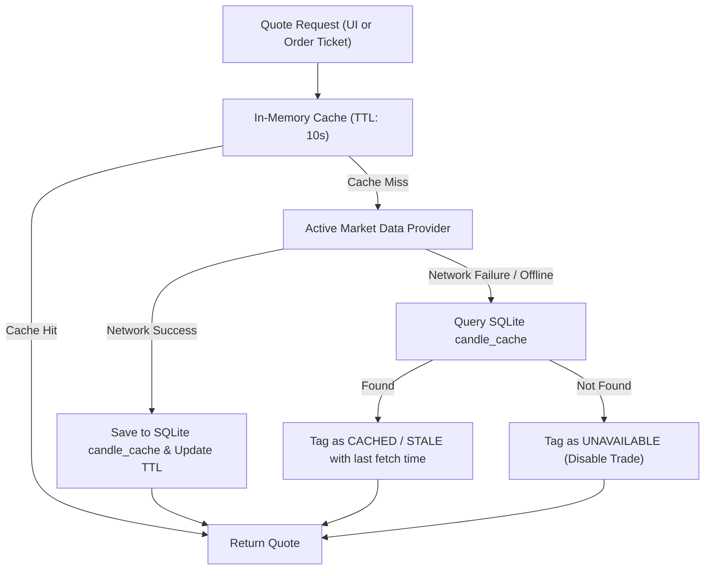

# Market Data Architecture, Provider Evaluation & Freshness Contract

**Date:** 17 October 2026  
**Auditor / Architect:** Data Infrastructure Architect & API Specialist  
**Deliverable Path:** `docs/architecture/market-data-architecture.md`  
**PRD Reference:** `PRD.md` Section 7 ("Market Data Strategy and Provider Evaluation")  

---

## 1. Non-Negotiable Policy & Ethical Boundaries

Per `PRD.md` Section 7.1:
1. **Zero Exchange Scraping:** MarketMimic strictly forbids scraping official exchange portals (such as `nseindia.com` or `bseindia.com`), solving CAPTCHAs, spoofing headers, or bypassing bot mitigations (Akamai/Cloudflare).
2. **Honest Freshness Attribution:** A quote is labeled **`LIVE`** only when its provider documentation and observed timestamps justify real-time execution. Free public feeds that are delayed by 15 minutes MUST be labeled **`DELAYED`**.
3. **No Fabricated Real-Time Claims:** Synthetic or demo data must never be presented as live market quotes.
4. **Offline First Resilience:** If internet connectivity drops or an external provider errors out, the application falls back gracefully to local SQLite cached quotes with a `CACHED` stale-data indicator.

---

## 2. Evaluation of Legitimate Free / Low-Cost Providers

| Provider / Source | Supported Indian Equities | Latency & Freshness | Permitted Usage & Terms | Technical Feasibility & Risks | Decision in MarketMimic |
|---|---|---|---|---|---|
| **Yahoo Finance API (Unauthenticated)** | High (NSE `.NS`, BSE `.BO` tickers) | **Delayed by 15 minutes** during Indian market hours (09:15–15:30 IST) | Personal, non-commercial use permitted; no commercial redistribution. | Endpoint `query1.finance.yahoo.com/v8/finance/chart/` is stable but unofficial; rate-limited to ~2,000 req/hour. | **Primary Delayed Provider** (labeled `DELAYED`). |
| **Bundled / User CSV Historical Files** | Full coverage for imported symbols | **Historical Replay** (Exact timestamp ticks) | 100% lawful when using user-owned or public historical archives. | Zero network requests; zero budget cost; 100% offline reliable. | **Primary Replay Provider** (labeled `REPLAY`). |
| **Deterministic Synthetic Engine** | Unlimited virtual instruments | **Immediate / Controlled Clock** | Full software ownership; zero external dependency. | Geometric Brownian motion with seeded random walk; ideal for automated unit tests. | **Default Seeded Provider** (labeled `DEMO`). |
| **Direct NSE / BSE Scraping** | High | Near-realtime | **Strictly Prohibited** by exchange terms of service. | Blocked by WAF/Akamai; high risk of IP banning; brittle parser maintenance. | **REJECTED.** |
| **Paid Commercial Feeds (Zerodha Kite, Upstox, TrueData)** | Complete exchange coverage | Sub-second Live WebSocket | Requires active brokerage account or paid monthly subscription (₹1,500–₹3,000/mo). | Violates ₹0 mandatory budget ceiling non-goal for MVP. | **Deferred to Post-MVP Optional Plugin.** |

---

## 3. Provider-Neutral TypeScript Interface

All market data consumption in MarketMimic routes through the `IMarketDataProvider` interface. The UI and financial engine never interact with network endpoints directly.

```typescript
import { InstrumentId, Quote, Candle, CandleInterval, Result } from './domain-contracts';

export interface MarketDataQuery {
  readonly instrumentId: InstrumentId;
  readonly providerSymbol: string;
}

export interface HistoricalCandleQuery extends MarketDataQuery {
  readonly interval: CandleInterval;
  readonly fromIso: string;
  readonly toIso: string;
}

export interface IMarketDataProvider {
  readonly providerId: string;
  readonly displayName: string;
  readonly defaultDataMode: 'LIVE' | 'DELAYED' | 'REPLAY' | 'DEMO';

  /** Fetch current snapshot quote */
  fetchQuote(query: MarketDataQuery): Promise<Result<Quote>>;

  /** Batch quote fetch to optimize network payloads */
  fetchQuotes(queries: MarketDataQuery[]): Promise<Result<Map<InstrumentId, Quote>>>;

  /** Fetch historical OHLCV candles */
  fetchHistoricalCandles(query: HistoricalCandleQuery): Promise<Result<Candle[]>>;

  /** Check current market session status */
  getMarketSessionStatus(): MarketSessionStatus;
}

export interface MarketSessionStatus {
  readonly isOpen: boolean;
  readonly sessionName: 'NORMAL' | 'PRE_OPEN' | 'POST_CLOSE' | 'CLOSED_WEEKEND' | 'CLOSED_HOLIDAY';
  readonly nextOpenTimeIso?: string;
}
```

---

## 4. Local Caching & Fallback Chain



### 4.1 Caching Policies
- **Intraday Quotes (`LTP`):** Cached in memory for 10 seconds during active viewing. Stored to SQLite on screen transitions.
- **Historical Daily Candles (`1D`):** Cached permanently in SQLite `candle_cache` once the session date has closed.
- **Cache Eviction:** Daily candles for past dates never expire; intraday 1-minute candles for older sessions purged after 30 days unless pinned to a replay session.

---

## 5. Historical Replay Engine Integration

In Historical Replay Mode:
1. The `ReplayMarketDataProvider` intercepts all quote and candle queries.
2. It evaluates only candles whose timestamps are `<= current_replay_clock`.
3. Any attempt to inspect future candles is strictly blocked at the provider boundary to eliminate look-ahead bias in simulation.
4. When the user steps the replay clock forward, the provider emits new quotes matching the historical tick and triggers order book evaluation.
