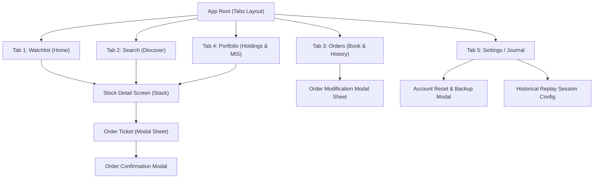

# MarketMimic Screen & Navigation Specification

**Date:** 17 October 2026  
**Auditor / Architect:** Senior Mobile Product Architect & React Native Engineer  
**Deliverable Path:** `docs/architecture/screen-specification.md`  
**Reference Evidence:** `docs/research/ux-evidence-log.md` (`OBS-01` through `OBS-11`)  
**Design System Reference:** `DESIGN.md`  

---

## 1. Primary Navigation Architecture

MarketMimic uses **Expo Router** file-based navigation organized around a 5-tab root layout (`app/(tabs)/_layout.tsx`) supplemented by modal sheets and detail stack screens.



---

## 2. Screen-by-Screen Specifications

### Screen `SCR-01`: Watchlist / Home Screen
- **Route:** `app/(tabs)/index.tsx` (or `app/(tabs)/watchlist.tsx`)
- **Purpose & User Intent:** Primary dashboard for monitoring market indices, checking active watchlist quotes, and launching stock inquiries.
- **Evidence Reference:** `OBS-01`, `OBS-10`, `OBS-11`.
- **Entry Points:** App launch (default tab) or tapping "Watchlist" bottom tab.
- **Navigation Destinations:**
  - Tap stock row -> `SCR-03` Stock Detail Screen.
  - Tap search bar -> `SCR-02` Search Screen.
  - Tap "Manage Watchlists" icon -> Watchlist Management Modal.
- **Information Hierarchy:**
  1. Top App Bar: Brand title ("MarketMimic"), Data Mode Badge (`LIVE` / `DELAYED` / `REPLAY` / `DEMO`), Account Balance pill (`₹1,00,000.00`).
  2. Index Carousel: Mini cards for benchmark indices (`NIFTY 50`, `BENSEX`) with LTP, change, and directional color.
  3. Watchlist Pill Bar: Horizontal tabs (`Watchlist 1`, `Nifty 50`, `Top Tech`, `+ New`).
  4. Stock Row List: Virtualized list (`FlashList` or `FlatList`) of tracked instruments.
- **Components & Actions:**
  - `HeaderStatusBar`: Shows active data provider and last sync timestamp.
  - `WatchlistTabPicker`: Switch active list; long-press to rename.
  - `StockListItem`: Displays Symbol, Company Name, Exchange chip (`NSE`/`BSE`), LTP, Day change ₹ and %. Pull-to-refresh action.
- **Required Domain Data:**
  - `Watchlist` record and associated `WatchlistItem[]`.
  - Current `Quote[]` mapped to instruments (LTP, close price, timestamp, mode).
- **States:**
  - **Loading:** Shimmer skeleton rows matching row dimensions.
  - **Empty:** "No stocks in this watchlist. Tap 'Search & Add' to track equities."
  - **Offline:** Subtle yellow/slate warning banner; cached quotes shown with `CACHED` badge and last fetch timestamp.
  - **Replay Mode:** Top bar replaced with Replay Control Strip (date, clock, speed, pause/play).
- **Validation & Business Rules:** Duplicate additions to the same watchlist prevented by unique constraint.
- **Accessibility:** Row announces: `"[Symbol], [Company Name], Last traded price [X] rupees, [Up/Down] [Y] rupees or [Z] percent"`.

---

### Screen `SCR-02`: Search & Instrument Discovery Screen
- **Route:** `app/(tabs)/search.tsx`
- **Purpose & User Intent:** Rapidly search, filter, and discover Indian cash equity instruments to view details or add to watchlists.
- **Evidence Reference:** `OBS-02`.
- **Entry Points:** Tapping "Search" bottom tab or search bar on Watchlist.
- **Navigation Destinations:**
  - Tap search result item -> `SCR-03` Stock Detail Screen.
  - Tap bookmark icon -> Adds/removes from active watchlist with instant toast.
- **Information Hierarchy:**
  1. Search Header: Auto-focused text input with clear ("X") button.
  2. Filter Chips: All, NSE, BSE.
  3. Pre-search State: "Recent Searches" and "Most Traded Indian Equities".
  4. Active Query Results: Ranked list of matching instruments.
- **Components & Actions:**
  - `SearchInput`: Debounced (150ms) text input.
  - `SearchResultItem`: Shows Symbol (highlighting query match), Company Name, Exchange chip, LTP, and bookmark toggle icon.
- **Required Domain Data:**
  - Local SQLite Instrument Master table (FTS5 search index).
  - Recent search history table in SQLite.
- **States:**
  - **Empty Query:** Displays recent searches with a "Clear History" CTA.
  - **No Matches Found:** "No equities found for '[Query]'. Check the symbol spelling or verify NSE/BSE listing."
  - **Searching:** Subtle inline activity spinner.
- **Validation Rules:** Query sanitized against SQL injection; search limited to cash equity instruments (derivatives excluded in MVP).
- **Accessibility:** Search results announce total match count on query completion.

---

### Screen `SCR-03`: Stock Detail & Chart Screen
- **Route:** `app/stock/[symbol].tsx` (Stack Screen)
- **Purpose & User Intent:** Deep analysis of an instrument's historical price movement, key statistics, and order entry trigger.
- **Evidence Reference:** `OBS-03`, `OBS-09`, `OBS-10`.
- **Entry Points:** Tapping any stock from Watchlist, Search, Orders, or Portfolio.
- **Navigation Destinations:**
  - Tap "BUY" CTA -> Opens `SCR-04` Order Ticket (Side = BUY).
  - Tap "SELL" CTA -> Opens `SCR-04` Order Ticket (Side = SELL).
  - Tap Back arrow -> Returns to previous route.
- **Information Hierarchy:**
  1. Header: Back button, Symbol ticker, Exchange toggle (`NSE` | `BSE`), Watchlist bookmark icon.
  2. Price Header: Current LTP (22sp Bold Mono), Absolute & Pct Change with direction glyph, Data Freshness tag (`LIVE` / `DELAYED` / `REPLAY`).
  3. Interactive Chart Area: Price line/area chart with timeframe selector pills (`1D`, `1W`, `1M`, `1Y`, `5Y`, `All`).
  4. Scrubbing Bar: Dynamic tooltip displaying price and time under finger.
  5. Today's Performance Card: Low-to-High price slider showing current position between open and close.
  6. 52-Week Range Card: 52W Low vs 52W High slider.
  7. Key Statistics Grid: Open, Previous Close, Volume, Upper Circuit, Lower Circuit.
  8. Existing Position Banner (if holding or open position exists): "You hold X shares • Avg ₹Y • P&L: ₹Z".
  9. Fixed Bottom Action Bar: "BUY" (Emerald Green) and "SELL" (Rose/Red) buttons.
- **Components & Actions:**
  - `SkiaPriceChart`: Native gesture-responsive candle/area chart.
  - `TimeframeSelector`: Switch candle interval; fetch corresponding historical records.
  - `StatRow`: Key financial data metrics.
- **Required Domain Data:**
  - `Instrument` master record.
  - Current `Quote` and historical `Candle[]` series.
  - User's `DeliveryHolding` and open `IntradayPosition` records for this symbol.
- **States:**
  - **Loading:** Shimmer over chart area and statistics grid.
  - **Missing Candles:** Shows clear placeholder: "Historical candles unavailable for this timeframe from provider." Never fabricates missing candles.
  - **Market Closed:** Banner indicates market is closed; displays Last Close quote.
- **Validation Rules:** If user owns zero shares, "SELL" CTA displays holding count (0) and prompts confirmation before allowing an intraday short check.
- **Accessibility:** Chart scrubber provides audio/haptic tick on passing high/low extrema.

---

### Screen `SCR-04`: Buy/Sell Order Ticket Modal Sheet
- **Route:** `app/order/ticket.tsx` (Slide-Up Modal Bottom Sheet)
- **Purpose & User Intent:** Configure, validate, and execute simulated equity trades (Delivery or Intraday, Market or Limit).
- **Evidence Reference:** `OBS-04`, `OBS-05`, `OBS-09`.
- **Entry Points:** Tapping "BUY" or "SELL" on Stock Detail Screen.
- **Navigation Destinations:**
  - Submit Order -> Dismisses sheet and opens `SCR-05` Order Confirmation Modal.
  - Cancel / Pull down -> Dismisses sheet without placing order.
  - Tap "Charges Details" -> Opens Statutory Charges Breakdown sub-modal.
- **Information Hierarchy:**
  1. Sheet Header: Drag handle, Side Indicator ("BUY TATAMOTORS" in green or "SELL TATAMOTORS" in red), Exchange badge, LTP.
  2. Product Segmented Pill: `[ Delivery (CNC) ]` | `[ Intraday (MIS) ]`.
  3. Order Type Segmented Pill: `[ Market ]` | `[ Limit ]`.
  4. Quantity Input: Large numeric display with step buttons (`-1`, `+1`, `+10`, `+25`, `Max`).
  5. Limit Price Input: Numeric input with tick size increment (₹0.05), disabled when Order Type is `Market`.
  6. Financial Summary Box:
     - "Approx. Order Value: ₹4,622.50"
     - "Estimated Charges: ₹4.80" (tappable to view STT, GST, etc.)
     - "Total Margin Required: ₹4,627.30"
     - "Available Virtual Balance: ₹1,00,000.00"
  7. Warning Area (Conditional):
     - Insufficient balance alert: "Insufficient funds. Required: ₹X, Available: ₹Y."
     - Intraday square-off disclosure: "Simulated auto-close scheduled for 15:20 IST."
     - Stale price warning (if quote > 60s old): "Price is delayed or stale. Limit order recommended."
  8. Primary Action CTA: Full-width button: "CONFIRM BUY ORDER" / "CONFIRM SELL ORDER".
- **Components & Actions:**
  - `QuantityStepper`: Integer keypad and quick increment chips.
  - `PriceInput`: Controlled input respecting tick rules (`paise % 5 === 0`).
  - `ChargesBreakdownModal`: Detailed breakdown of brokerage, STT, turnover fees, GST.
- **Required Domain Data:**
  - Account available virtual cash balance (`cash_paise`).
  - Active instrument quote and tick size.
  - Delivery holding available quantity (for Sell orders).
  - Configured transaction fee schedule and slippage model.
- **Validation Rules:**
  - Quantity MUST be a positive integer (`quantity > 0 && Number.isInteger(quantity)`).
  - Limit Price MUST be a positive integer paise matching tick size.
  - If Side is `BUY`: Required Cash (`value + estimated_fees`) MUST be `<= available_cash`.
  - If Side is `SELL` & Product is `DELIVERY`: Quantity MUST be `<= available_delivery_quantity`.
  - If Side is `SELL` & Product is `INTRADAY`: Quantity MUST be `<= open_intraday_quantity` (long-only rule for MVP).
  - Primary CTA disabled whenever validation fails.
- **Accessibility:** Screen reader announces: *"Order ticket for [Symbol]. Buy [Quantity] shares at [Price]. Required funds: [Amount]. Available: [Amount]"*.

---

### Screen `SCR-05`: Order Confirmation & Execution Feedback Modal
- **Route:** `app/order/confirm.tsx` (Dialog Modal)
- **Purpose & User Intent:** Instant visual and tactile confirmation of trade execution or placement on the order book.
- **Evidence Reference:** `OBS-06`.
- **Entry Points:** Successful submission from `SCR-04`.
- **Navigation Destinations:**
  - "Done" button -> Returns to Stock Detail or Watchlist.
  - "View Orders" button -> Navigates to `SCR-06` Orders Tab.
- **Information Hierarchy:**
  1. Animated Checkmark or Pending Clock icon (Emerald Green for fills, Amber for pending limit).
  2. Headline: "Order Executed Successfully!" (or "Limit Order Placed on Order Book").
  3. Detail Receipt:
     - Symbol & Exchange (`RELIANCE • NSE`)
     - Side & Product (`BUY • DELIVERY`)
     - Quantity & Fill Price (`5 Shares @ ₹2,940.00`)
     - Total Amount Debited / Credited (`₹14,714.80 incl. ₹14.80 charges`)
     - Order ID and Timestamp.
  4. Educational Disclaimer: *"Simulated Paper Trade • Virtual capital only."*
  5. Action Buttons: "Done" and "Go to Orders".
- **Validation & Consistency:** Generates idempotent record; prevents duplicate submission if tapped multiple times.
- **Accessibility:** Trigger Android haptic feedback (`notificationAsync(Success)`) upon display.

---

### Screen `SCR-06`: Orders Screen (Order Book & History)
- **Route:** `app/(tabs)/orders.tsx`
- **Purpose & User Intent:** Monitor active open limit orders, cancel/modify pending orders, and review past execution history.
- **Evidence Reference:** `OBS-07`.
- **Entry Points:** Tapping "Orders" tab in bottom navigation.
- **Navigation Destinations:**
  - Tap "Modify" on open order -> Opens Order Modification Sheet.
  - Tap order item -> Opens Detailed Order Lifecycle Audit.
- **Information Hierarchy:**
  1. Top Segmented Filter: `[ Open Orders (N) ]` | `[ Executed & Past ]`.
  2. Open Orders List:
     - Symbol, Product (`CNC` / `MIS`), Order Type (`LIMIT`), Placed Time.
     - Quantity (Pending / Total).
     - Limit Price vs Current LTP.
     - Quick Action Buttons: "Modify" (Adjust price/qty) and "Cancel" (Destructive red outline).
  3. Executed Orders List:
     - Symbol, Product, Side (`BUY` Green / `SELL` Red).
     - Execution Price, Filled Quantity, Total Value.
     - Final Status Badge: `FILLED` (Green), `CANCELLED` (Slate), `REJECTED` (Red), `EXPIRED` (Amber).
     - Execution Timestamp.
- **Components & Actions:**
  - `OrderBookItem`: Displays status and action triggers.
  - `CancelConfirmDialog`: Confirms intent before revoking pending limit order.
- **Required Domain Data:**
  - SQLite `orders` joined with `instruments` and `fills`.
- **States:**
  - **Empty Open Orders:** "No active open orders. Limit orders waiting for market trigger will appear here."
  - **Empty History:** "No executed orders yet. Place your first paper trade from the Watchlist."
- **Validation Rules:**
  - An order in status `FILLED`, `CANCELLED`, or `REJECTED` cannot be cancelled or modified.
  - Modifying limit order performs real-time margin re-validation.
- **Accessibility:** Open order item states clearly: *"Pending limit buy for 10 shares of Tata Motors at 900 rupees. Current price 920 rupees."*

---

### Screen `SCR-07`: Portfolio Screen (Holdings & Intraday Positions)
- **Route:** `app/(tabs)/portfolio.tsx`
- **Purpose & User Intent:** Track total wealth, delivery equity holdings, open intraday trades, and overall realized/unrealized P&L.
- **Evidence Reference:** `OBS-08`, `OBS-09`, `OBS-11`.
- **Entry Points:** Tapping "Portfolio" tab in bottom navigation.
- **Navigation Destinations:**
  - Tap holding item -> Opens holding detail modal with "Add More" / "Sell" options.
  - Tap "Square Off All" -> Opens bulk intraday exit confirmation dialog.
- **Information Hierarchy:**
  1. Portfolio Summary Card (Prominent Top Card):
     - Total Portfolio Value: `₹1,04,250.00` (Display Header Mono).
     - Total Unrealized P&L: `+₹4,250.00 (+4.25%)` (Emerald).
     - 1-Day Return: `+₹820.00 (+0.79%)`.
     - Sub-bar: Available Virtual Cash: `₹65,000.00` • Invested: `₹35,000.00`.
  2. Segmented Navigation Tabs: `[ Holdings (N) ]` | `[ Positions (N) ]`.
  3. Holdings Tab List:
     - Ticker, Quantity shares.
     - Avg Buy Price, Current LTP.
     - Current Value, Total Returns ₹ and %.
  4. Positions Tab List:
     - Ticker, Net Open Quantity.
     - Average Entry Price, LTP.
     - Intraday Unrealized P&L.
     - "Exit Position" individual CTA button.
     - Persistent Bottom CTA: "Square Off All Intraday" (Red pill).
- **Components & Actions:**
  - `PortfolioHeroCard`: Primary wealth overview.
  - `HoldingsRow`: Swipe-to-sell shortcut.
  - `PositionsRow`: Real-time mark-to-market tracker.
- **Required Domain Data:**
  - SQLite `delivery_holdings` joined with latest quotes.
  - SQLite `intraday_positions` for current session.
  - Cash balance from `cash_ledger`.
- **States:**
  - **Empty Holdings:** "Your portfolio is empty. Explore watchlists to start paper trading with your ₹1,00,000 virtual balance."
  - **Empty Positions:** "No open intraday positions for today's session."
- **Validation Rules:**
  - Total portfolio value calculation MUST equal: `available_cash + sum(holdings.quantity * ltp) + sum(positions.unrealized_pnl)`.
  - Double-counting strictly prevented.
- **Accessibility:** Announces total net worth and profit breakdown on screen load.

---

### Screen `SCR-08`: Profile, Journal & Simulation Settings Screen
- **Route:** `app/(tabs)/profile.tsx` (or `app/(tabs)/settings.tsx`)
- **Purpose & User Intent:** Configure simulation parameters, access the trading journal, inspect data source status, export database backups, or reset virtual account.
- **Evidence Reference:** `OBS-10`, `OBS-11`.
- **Entry Points:** Tapping "Profile / Settings" tab in bottom navigation.
- **Navigation Destinations:**
  - Tap "Trading Journal" -> Navigates to Journal entries and analytics list.
  - Tap "Simulation & Market Data" -> Opens Data Mode & Provider Configuration.
  - Tap "Export Data" -> Generates JSON/SQLite file for sharing or storage.
  - Tap "Reset Account" -> Opens Destructive Reset confirmation dialog.
- **Information Hierarchy:**
  1. Virtual Account Banner: Current Virtual Balance, Account Creation Date, Simulation Mode.
  2. Trading Journal & Analytics Section:
     - "My Trade Notes (N entries)"
     - "Simulator Performance & Win Rate"
  3. Simulator Settings:
     - Data Mode: `[ Live/Delayed ]` | `[ Historical Replay ]` | `[ Demo ]`
     - Fee Schedule: `[ Realistic Indian Statutory ]` | `[ Zero-Fee Mode ]`
     - Slippage Model: `[ Adverse 0.05% ]` | `[ Zero Slippage ]`
     - Intraday Auto-Square-off Time: `[ 15:20 IST ]`
  4. Data & Backup Controls:
     - Data Source Status & Provider Attribution
     - "Export Portfolio & Journal Backup (JSON)"
     - "Reset Virtual Account to ₹1,00,000" (Red Text)
  5. Regulatory Disclaimers & App Info:
     - Version number, SQLite schema migration version.
     - Clear disclaimer: *"MarketMimic is a private paper-trading simulator for educational use only. Not affiliated with Groww, NSE, or BSE."*
- **Components & Actions:**
  - `SettingsRow`: Toggle switch or modal trigger.
  - `AccountResetDialog`: Multi-step confirmation modal requiring typing "RESET" to prevent accidental data loss.
- **Validation Rules:** Account reset wipes local database tables atomically and re-seeds starting capital of ₹1,00,000 with a clean initial ledger entry.

---

## 3. Exceptional Interaction Flows

### Flow 1: Stale Price or Delayed Data Alert
```text
User opens Order Ticket -> Active Quote is flagged as DELAYED (15m) or STALE (>60s)
-> Ticket displays prominent Amber Banner: "Market quote is delayed by 15 mins. Market orders will fill at prevailing delayed reference price."
-> If user selects Market Order: Confirmation dialog requires explicit acknowledgment: "Accept Slippage & Delayed Fill?"
-> If user selects Limit Order: Normal execution flow proceeding.
```

### Flow 2: Market-Closed Order Submission
```text
User submits Order at 18:00 IST (outside 09:15-15:30 IST)
-> Order Ticket checks market status -> Returns MARKET_CLOSED
-> Ticket displays option: "Place as After-Market Order (AMO) for next 09:15 AM open" or "Test trade immediately in Historical Replay Mode"
-> If AMO selected: Order stored with status CREATED / QUEUED_AMO
-> If Replay selected: Redirects user to Replay Session Setup.
```

### Flow 3: Intraday Session Close Warning & Auto-Square-Off
```text
Replay Clock or Real Clock reaches 15:15 IST
-> App triggers prominent Notification Banner: "Intraday Auto-Square-off approaching at 15:20 IST. You have 2 open positions."
-> At 15:20 IST: Engine executes simulated market exits for all open intraday positions at prevailing 15:20 quote
-> Positions transition to CLOSED; Realized P&L updated; Notification confirms: "2 Intraday positions auto-squared off."
```
