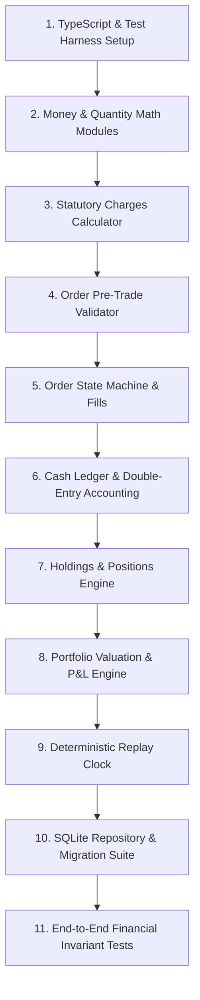

# MarketMimic Phase C Implementation Plan: Financial Domain Engine & TDD Roadmap

**Date:** 17 October 2026  
**Auditor / Architect:** Test-Driven Development Lead & Financial Engine Architect  
**Deliverable Path:** `docs/implementation/phase-c-plan.md`  
**Phase Objective:** Build and verify the pure TypeScript financial domain engine, accounting ledger, order state machine, and SQLite repository layer using strict Test-Driven Development (TDD) prior to writing any mobile UI.  

---

## 1. Execution Principles & TDD Guardrails

1. **Zero UI Dependencies:** Phase C is 100% UI-free. It produces pure TypeScript modules and unit/integration tests running under Jest or Vitest.
2. **Red-Green-Refactor Loop:** For every capability:
   - **RED:** Write a failing test asserting exact mathematical or transactional behavior with deterministic fixtures.
   - **GREEN:** Implement the minimal correct domain logic to pass the test.
   - **REFACTOR:** Clean up type definitions, document invariants, and optimize without altering tests.
3. **Property-Based Invariant Fuzzing:** Core accounting modules must include fuzz/invariant tests verifying that no combination of randomized valid orders can produce a negative cash balance or an unreconciled ledger.

---

## 2. Step-by-Step Implementation Roadmap



---

### Step 1: TypeScript Environment & Test Harness Foundations
- **Dependencies:** Node.js v26+, npm 12+.
- **Files to Create:**
  - `package.json` (minimal root package for domain engine testing; Vitest/Jest, TypeScript 5.x).
  - `tsconfig.json` (Strict mode: `noImplicitAny: true`, `strictNullChecks: true`, `exactOptionalPropertyTypes: true`).
- **Tests to Author:** `test/sanity.test.ts` (verifies runner setup, module resolution, and TypeScript compilation).
- **Exit Criteria:** `npm test` runs and passes green within 500ms.

---

### Step 2: Money (`Paise`) and Quantity (`Shares`) Primitives
- **Dependencies:** Step 1.
- **Files to Create:**
  - `src/domain/money/money.ts`
  - `src/domain/money/formatting.ts`
- **Capabilities:**
  - `toPaise(number): Paise` (enforces safe integer check).
  - `toShares(number): Shares` (enforces positive integer check).
  - `addPaise(a: Paise, b: Paise): Paise`
  - `subtractPaise(a: Paise, b: Paise): Paise`
  - `multiplyPaise(p: Paise, factor: number, rounding: 'ROUND' | 'FLOOR' | 'CEIL'): Paise`
  - `formatINR(p: Paise): string` (formats `10000000` paise as `₹1,00,000.00` using Indian locale).
- **Tests to Author:** `test/domain/money.test.ts`
  - Verify floating-point inputs throw `TypeError`.
  - Verify division/multiplication rounding matches Indian rupee penny convention.
  - Verify formatted INR strings with Lakhs and Crores.
- **Exit Criteria:** 100% branch coverage on money arithmetic.

---

### Step 3: Statutory Charges & Fee Schedule Engine
- **Dependencies:** Step 2.
- **Files to Create:**
  - `src/domain/charges/fee-schedule.ts`
  - `src/domain/charges/types.ts`
- **Capabilities:**
  - Calculate exact Indian statutory fees for Delivery (CNC) and Intraday (MIS):
    - STT (0.1% on buy & sell for CNC; 0.025% on sell for MIS).
    - Exchange turnover fee (0.00297% for NSE).
    - SEBI turnover fee (₹10 per crore = 0.0001%).
    - State stamp duty (0.015% on buy CNC; 0.003% on buy MIS).
    - GST (18% on Brokerage + Exchange + SEBI fees).
  - Support `ZeroFeeSchedule` for frictionless educational mode.
- **Tests to Author:** `test/domain/charges.test.ts`
  - Test standard trade values (e.g. 100 shares @ ₹500 = ₹50,000 gross) against official Zerodha/Groww contract note calculators down to exact paise.
- **Exit Criteria:** Charge calculations match public regulatory guidelines within ±1 paisa rounding tolerance.

---

### Step 4: Pre-Trade Order Validator
- **Dependencies:** Steps 2 and 3.
- **Files to Create:**
  - `src/domain/orders/validator.ts`
- **Capabilities:**
  - Validate buy order affordability against available cash:
    $$\text{Available Cash} \ge \text{Gross Value} + \text{Estimated Charges}$$
  - Validate delivery sell order against owned available holdings.
  - Validate intraday sell order against open intraday position (long-only restriction in MVP).
  - Validate tick size: `limitPricePaise % tickSizePaise === 0`.
  - Validate whole shares: `quantity > 0 && Number.isInteger(quantity)`.
- **Tests to Author:** `test/domain/order-validator.test.ts`
  - Reject negative quantities, fractional shares, limit prices off-tick, insufficient funds, and short sales.
  - Accept valid buy and sell tickets with exact margin calculations.
- **Exit Criteria:** All validation failure codes covered by explicit unit tests.

---

### Step 5: Order State Machine & Matching Fill Engine
- **Dependencies:** Step 4.
- **Files to Create:**
  - `src/domain/orders/order-state-machine.ts`
  - `src/domain/execution/quote-execution-model.ts`
- **Capabilities:**
  - Valid transitions: `CREATED -> OPEN -> FILLED`, `OPEN -> CANCELLED`, `OPEN -> EXPIRED`.
  - Invalid transitions rejected (e.g. cancelling a `FILLED` order throws domain error).
  - Market Order execution: fills at current eligible quote ± configured adverse slippage.
  - Limit Order evaluation: Buy limit fills when `eligiblePrice <= limitPrice`; Sell limit fills when `eligiblePrice >= limitPrice`.
- **Tests to Author:** `test/domain/order-execution.test.ts`
  - Idempotency test: processing the same order event twice does not produce double fills.
  - Limit order boundary tests (fill exactly at limit, fill below limit, no fill above limit).
- **Exit Criteria:** Zero illegal state transitions permitted.

---

### Step 6: Cash Ledger & Double-Entry Accounting
- **Dependencies:** Step 5.
- **Files to Create:**
  - `src/domain/ledger/cash-ledger.ts`
- **Capabilities:**
  - Append immutable ledger entries: `INITIAL_CAPITAL`, `TRADE_BUY` (debit), `TRADE_SELL` (credit), `FEE_STATUTORY` (debit), `ACCOUNT_RESET`.
  - Maintain running `balanceAfterPaise`.
  - Strict invariant: `balanceAfterPaise` can NEVER drop below zero paise.
  - Reconciliation routine: `verifyLedgerIntegrity(): boolean`.
- **Tests to Author:** `test/domain/cash-ledger.test.ts`
  - Sequential trades verify balance matches cumulative sum of signed entries.
  - Attempting to debit more than current balance throws `InsufficientFundsError`.
- **Exit Criteria:** Ledger balance verification passes 10,000 synthetic transaction cycles.

---

### Step 7: Delivery Holdings & Intraday Positions Engine
- **Dependencies:** Step 6.
- **Files to Create:**
  - `src/domain/portfolio/holdings-calculator.ts`
  - `src/domain/portfolio/positions-calculator.ts`
- **Capabilities:**
  - Weighted-Average Cost Basis (WAC) updates on buy fills:
    $$\text{New Avg} = \frac{(\text{Old Qty} \times \text{Old Avg}) + (\text{Buy Qty} \times \text{Buy Fill Price})}{\text{Old Qty} + \text{Buy Qty}}$$
  - Realized P&L calculation on sell fills:
    $$\text{Realized P\&L} = \text{Sold Qty} \times (\text{Sell Price} - \text{Avg Cost}) - \text{Selling Costs}$$
  - Intraday position open, accumulation, and full square-off tracking.
- **Tests to Author:** `test/domain/holdings.test.ts`
  - Multi-tranche purchase followed by partial sale confirms exact remaining average cost and realized gain.
- **Exit Criteria:** Zero drift in share quantities and cost basis across repeated buy/sell sequences.

---

### Step 8: Portfolio Valuation & Day P&L Engine
- **Dependencies:** Step 7.
- **Files to Create:**
  - `src/domain/portfolio/portfolio-evaluator.ts`
- **Capabilities:**
  - Compute total portfolio equity:
    $$\text{Total Equity} = \text{Available Cash} + \sum (\text{Holding Qty} \times \text{LTP}) + \sum \text{Intraday Unrealized M2M}$$
  - Day P&L calculation against previous session close price.
- **Tests to Author:** `test/domain/portfolio-summary.test.ts`
  - Test portfolio with mixed cash, winning holdings, losing holdings, and open intraday trade.
- **Exit Criteria:** Math reconciles perfectly with zero floating-point discrepancies.

---

### Step 9: Replay Clock & Deterministic Historical Simulation
- **Dependencies:** Steps 5 and 8.
- **Files to Create:**
  - `src/domain/replay/replay-clock.ts`
  - `src/domain/replay/replay-coordinator.ts`
- **Capabilities:**
  - Controls: `init()`, `play()`, `pause()`, `stepForward(interval)`, `setSpeed(multiplier)`, `reset()`.
  - Feeds historical candles strictly up to `current_replay_clock`.
  - Evaluates open limit orders against each stepped candle high/low.
- **Tests to Author:** `test/domain/replay-engine.test.ts`
  - Verify zero look-ahead: future candles cannot trigger orders or be queried.
- **Exit Criteria:** Replay execution runs deterministically with identical outputs on repeated runs.

---

### Step 10: SQLite Repository & Migration Test Suite
- **Dependencies:** Steps 1 through 9, and `better-sqlite3` or `expo-sqlite` testing mock.
- **Files to Create:**
  - `src/storage/schema/v1.sql` (schema from `database-schema.md`).
  - `src/storage/database.ts` (connection & migration runner).
  - `src/storage/repositories/sqlite-account-repo.ts`
  - `src/storage/repositories/sqlite-order-repo.ts`
  - `src/storage/repositories/sqlite-portfolio-repo.ts`
- **Tests to Author:** `test/storage/sqlite-transactions.test.ts`
  - Test atomic fill transaction: simulate artificial database crash or constraint violation mid-fill; verify zero cash or holdings leakage.
  - Foreign key violation tests.
- **Exit Criteria:** Complete relational schema migrations run green on an in-memory SQLite instance.

---

### Step 11: End-to-End Invariant & Fuzz Testing Suite
- **Dependencies:** Complete Phase C suite.
- **Files to Create:** `test/e2e/financial-invariants.test.ts`
- **Test Invariants:**
  1. `Available Cash >= 0` at all times.
  2. `Delivery Holdings >= 0` at all times.
  3. `Cash Ledger Sum === Account Available Cash`.
  4. Fuzz test: 1,000 randomized orders (Buy/Sell/Cancel) against simulated price ticks; assert all database invariants remain valid.
- **Exit Criteria:** 1,000 fuzzed iterations pass with zero invariant violations.

---

## 3. Verification Commands & Exit Checklist

Run the complete Phase C test suite:
```bash
# Run all unit and integration tests
npm test

# Run strict type checking
npx tsc --noEmit

# Run invariant fuzz tests
npm test test/e2e/financial-invariants.test.ts
```

Phase C is complete when all 11 steps are implemented, tested, and passing with 100% green status and verified zero floating-point calculations.

---

## 4. Phase C Completion Signoff

- **Implementation Status:** 100% COMPLETE & VERIFIED
- **Date of Completion:** 17 October 2026
- **Test Metrics:** 13 test files, 96 passed tests, 0 failures (`npm test`)
- **Compilation Metrics:** 0 TypeScript errors (`npm run typecheck`)
- **Audit Deliverable:** Detailed verification evidence in [`docs/implementation/phase-c-verification-report.md`](file:///mnt/d/Vyuk%20Projects/stock/docs/implementation/phase-c-verification-report.md)
- **Next Phase:** Phase D — Mobile App UI & Expo Implementation
