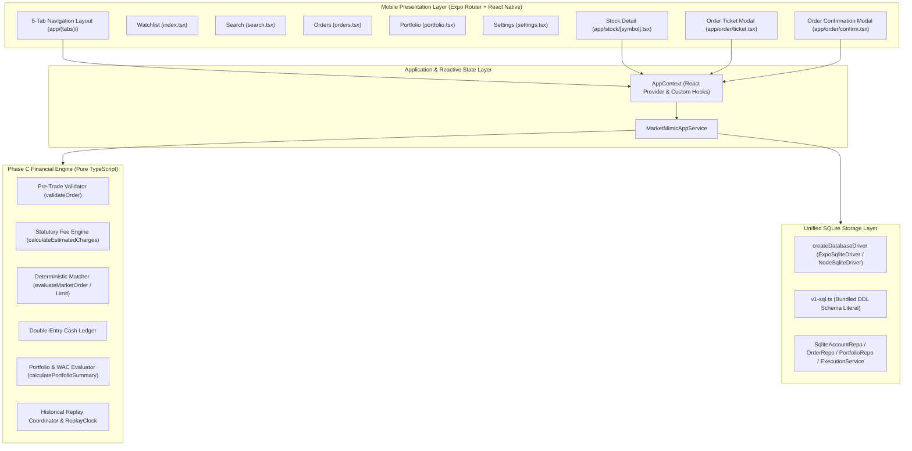

# Phase D Architecture: React Native, Expo & Financial Engine Integration

**Date:** 17 October 2026  
**Author:** Senior React Native & Expo Engineer, Android Application Architect  
**Project:** MarketMimic  
**Deliverable Path:** `docs/implementation/phase-d-architecture.md`  

---

## 1. Executive Architecture Summary

Phase D successfully bridges MarketMimic's deterministic financial domain engine and SQLite persistence foundations with a production-grade, offline-first React Native + Expo Android mobile application.

MarketMimic provides an authentic personal equity paper-trading simulation environment tailored for the Indian markets (NSE & BSE) adhering to a strict ₹0 cloud dependency ceiling. All portfolio bookkeeping, order validation, statutory fee computations, and market replays run natively on the mobile client.

---

## 2. Layered Architecture & Separation of Concerns

### 2.1 Pure Financial Domain Engine (Zero UI / Zero React Dependencies)
Preserved from Phase C and 100% verified:
- **Zero Floating-Point Arithmetic:** All monetary balances, transaction charges, and stock prices are represented in branded integer `Paise` (1 INR = 100 Paise).
- **Double-Entry Cash Ledger:** Every rupee moved is tracked across authoritative ledger accounts (`CASH`, `EQUITY_DELIVERY`, `SECURITIES_FEES`, `TRADING_PNL`).
- **Weighted Average Cost (WAC):** Delivery holdings calculate cost bases and realized gains according to Indian accounting standards.
- **Realistic Statutory Charges:** Standard Indian fee schedule incorporates delivery/intraday STT (0.1%), Exchange turnover charges (0.00297%), SEBI turnover fees, GST (18%), and Stamp duty (0.015%).
- **Deterministic Historical Replay:** `ReplayClock` and `ReplayCoordinator` reveal historical candles tick-by-tick and execute limit orders when price bounds are crossed.

### 2.2 Unified SQLite Persistence Adapter
To allow seamless execution both on the Android physical device (via `expo-sqlite` `openDatabaseSync`) and inside Node.js test runners (via `node:sqlite` `DatabaseSync`):
- **`ISqliteDatabase` Interface:** Standardized abstraction supporting `exec`, `prepare`, `run`, `get`, `all`.
- **`createDatabaseDriver` Factory:** Dynamically binds `ExpoSqliteDriver` when running on React Native / Expo, and `NodeSqliteDriver` when running under Vitest/Node.
- **No Runtime Filesystem Node Dependencies:** Metro bundler does not bundle Node's `fs` or `path` modules on Android. All SQLite DDL schemas are bundled as TypeScript string constants in `src/storage/schema/v1-sql.ts`.

### 2.3 Application Service & Reactive Context Layer
Located in `src/services/app-service.ts` and `src/services/AppContext.tsx`:
- **`MarketMimicAppService`:** High-level facade orchestrating order placement, pre-trade validation, position square-offs, watchlist toggling, and historical replay.
- **`AppContext`:** React context maintaining cached quotes, virtual cash balances, holdings, positions, and active orders.
- **Specialized Hooks:**
  - `useApp()`: Global application status, data mode (`DEMO`, `LIVE`, `DELAYED`, `REPLAY`), replay controls.
  - `useAccount()`: Available virtual cash, account identifier, account reset.
  - `usePortfolio()`: Total portfolio valuation, holdings list, open intraday positions, square-off triggers.
  - `useOrders()`: Open limit orders, execution history, order cancellation, order submission.
  - `useWatchlist()`: Active watchlist items, watchlist switcher, bookmark toggling.
  - `useMarketData()`: Instrument search, quote retrieval, ticker lookups.

### 2.4 Presentation & Navigation Layer (Expo Router)
Built with file-based Expo Router navigation matching `docs/architecture/screen-specification.md`:
- `app/_layout.tsx`: Root layout with `SafeAreaProvider`, `ThemeProvider`, `AppProvider`, dark status bar, and root `Stack`.
- `app/(tabs)/_layout.tsx`: Bottom tab bar with 5 primary sections:
  1. `app/(tabs)/index.tsx`: Watchlist & Market Overview (SCR-01).
  2. `app/(tabs)/search.tsx`: Instrument Search & Discovery (SCR-02).
  3. `app/(tabs)/orders.tsx`: Order Book & Execution History (SCR-06).
  4. `app/(tabs)/portfolio.tsx`: Portfolio, Holdings & Positions (SCR-07).
  5. `app/(tabs)/settings.tsx`: Settings, Transparency & Reset (SCR-08).
- Stack & Modal Screens:
  - `app/stock/[symbol].tsx`: Instrument Detail & Interactive Chart (SCR-03).
  - `app/order/ticket.tsx`: Pre-trade Order Ticket Modal Sheet (SCR-04).
  - `app/order/confirm.tsx`: Order Confirmation & Execution Receipt (SCR-05).
  - `app/+not-found.tsx`: Fallback route screen.

---

## 3. Design System & Accessibility Compliance

Adheres strictly to `DESIGN.md`:
- **Canvas & Surface Palette:** Dark Canvas `#090D16`, Dark Surface `#111827`, Elevated `#1F2937`, Subtle Borders `#1F2937`.
- **Financial Directional Semantics:** Bullish/Positive Emerald `#00D09C`, Bearish/Negative Rose `#EB5B3C`, Neutral Slate `#9CA3AF`.
- **Honest Data Attribution Badges:**
  - `LIVE`: Green (`#00D09C`)
  - `DELAYED`: Amber (`#F59E0B`)
  - `REPLAY`: Purple (`#A855F7`)
  - `CACHED`: Slate (`#9CA3AF`)
  - `DEMO`: Sky Blue (`#38BDF8`)
- **Accessibility:**
  - Touch targets minimum 48dp on Android.
  - High-contrast text exceeding WCAG AAA standards.
  - Screen reader accessibility labels on all interactive pressables.
  - Tabular monospace numbers for price alignment.

---

## 4. Zero Cloud Cost Guarantee

| Architectural Requirement | Implementation | Cost |
|---|---|---|
| User Database | Local SQLite on Android device | ₹0 |
| Financial Calculation Engine | Local client-side pure TypeScript | ₹0 |
| Pre-trade Order Validation | Client-side deterministic validator | ₹0 |
| Market Data & Replay | Embedded seed quotes & historical candle replay | ₹0 |
| Cloud Services / APIs | None required | ₹0 |
