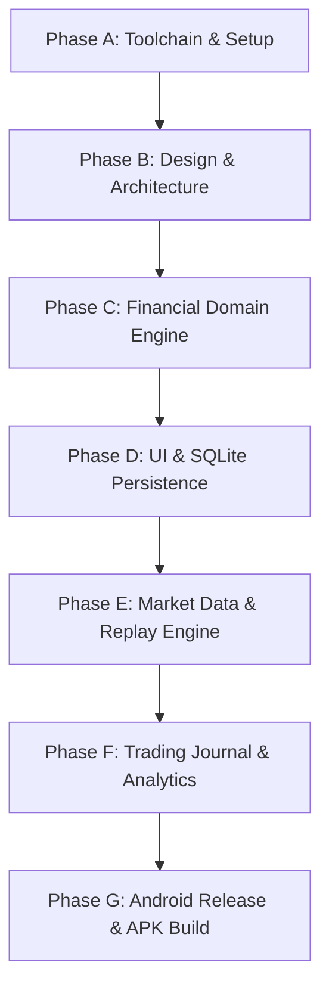

# MarketMimic Phased Implementation Master Plan

**Date:** 17 October 2026  
**Version:** 1.0  
**PRD Baseline:** `PRD.md` v1.0 (17 October 2026)  
**Deliverable Path:** `docs/implementation/phase-plan.md`  

---

## 1. Plan Overview and Architectural Principles

MarketMimic is an independently built, private, personal-use Indian stock-market paper-trading Android application. This phased plan maps the complete requirements from `PRD.md` into seven discrete, verifiable phases (Phase A through Phase G).

### Core Architectural Guarantees
1. **Zero Operating Budget:** Zero required recurring cloud costs, paid APIs, or paid subscriptions.
2. **Local-First SQLite:** All portfolio balances, orders, fills, trade journals, and historical cache reside on-device.
3. **Deterministic Financial Math:** Zero floating-point currency representation; all prices, costs, fees, and P&L are computed in integer paise (1 INR = 100 paise) with explicit rounding.
4. **Data Freshness Transparency:** Every quote and chart visibly declares whether it is Live, Delayed, Historical-Replay, Cached, or Mock.
5. **No Blind Copying:** Original branding, tokens, layouts, and code derived from clean-room behavioral observation.

---

## 2. Detailed Phase Specifications

---

### Phase A — Environment, Toolchain & Preparation
*Status: Completed in current setup milestone.*
- **Objectives:** Establish the baseline workspace, audit repository boundaries, install and verify agent skills, audit REA capabilities, and document Android build requirements.
- **Dependencies:** Operating system, Node.js, Git, Antigravity CLI.
- **Deliverables:**
  - `docs/setup/baseline-audit.md`
  - `docs/setup/skill-inventory.md`
  - `docs/setup/skill-installation-log.md`
  - `docs/research/rea-capability-audit.md`
  - `docs/research/groww-observation-plan.md`
  - `docs/setup/android-build-readiness.md`
  - `docs/implementation/phase-plan.md`
  - Project `.gitignore` and `skills-lock.json`
- **Acceptance Criteria:** All baseline audits complete, 9 project skills installed and verified in `.agents/skills/`, zero unauthorized modifications outside `/mnt/d/Vyuk Projects/stock/`.
- **Required Tests:** `skills list -a antigravity --json`, `git status`.
- **Skills Invoked:** `agy-customizations`, `find-skills`.
- **Definition of Done:** Verified clean workspace with complete documentation and approved lockfile.

---

### Phase B — Product Design & System Architecture
- **Objectives:** Design the original visual identity (MarketMimic), define the design tokens (`DESIGN.md`), establish screen hierarchies, specify the SQLite relational schema, and define the market data adapter contract.
- **Dependencies:** Phase A completed, `PRD.md` Sections 4, 6, and 7.
- **Deliverables:**
  - `docs/design/design-system.md` & `DESIGN.md` (color palette, typography, spacing, semantic tokens, dark/light themes).
  - `docs/design/screen-specifications.md` (Watchlist, Search, Stock Detail, Order Ticket, Orders, Portfolio, Journal).
  - `docs/architecture/sqlite-schema.sql` (Tables: `accounts`, `ledger_entries`, `orders`, `fills`, `holdings`, `positions`, `watchlists`, `watchlist_items`, `journal_entries`, `candle_cache`).
  - `docs/architecture/market-data-contract.ts` (TypeScript interfaces: `MarketDataAdapter`, `Quote`, `Candle`, `MarketStatus`, `DataMode`).
  - `docs/architecture/execution-model.md` (Rules for market fills, limit order matching, circuit limit halts, and delivery vs intraday accounting).
- **Acceptance Criteria:** Original styling free of generic AI slop; complete TypeScript interfaces; ACID-compliant SQLite schema with indexes and foreign keys.
- **Required Tests:** Schema syntax validation; type-checking of data contracts.
- **Skills to Invoke:** `impeccable`, `stitch-design-taste`, `high-end-visual-design`, `expo-design-system`.
- **Definition of Done:** Architecture artifacts reviewed and signed off against PRD non-goals and goals.

---

### Phase C — Financial Domain Engine (Pure TypeScript)
- **Objectives:** Implement the core business logic of paper trading as a standalone, deterministic, zero-dependency domain engine before connecting any UI.
- **Dependencies:** Phase B data contracts and schema specifications.
- **Deliverables:**
  - `src/domain/money/` (Integer paise arithmetic, formatting `₹1,00,000.00`, zero floating-point rounding errors).
  - `src/domain/orders/` (Order state machine: `PENDING`, `FILLED`, `CANCELLED`, `REJECTED`; market and limit order evaluation).
  - `src/domain/ledger/` (Double-entry transaction ledger; virtual cash debits/credits; locked margin tracking).
  - `src/domain/portfolio/` (FIFO lot matching for Delivery holdings; real-time average buy price calculation; Intraday open positions).
  - `src/domain/charges/` (Statutory charges calculator: STT, Exchange turnover charges, SEBI turnover fees, Stamp duty, GST).
  - `src/domain/pnl/` (Realized P&L and unrealized P&L calculations).
- **Acceptance Criteria:** 100% deterministic arithmetic; negative cash balance prevention; accurate FIFO liquidation of lots; exact regulatory tax calculations.
- **Required Tests:** Comprehensive Jest/Vitest unit test suite with 100% test coverage over money, fills, FIFO lot matching, and margin rules.
- **Skills to Invoke:** `test-driven-development`, `systematic-debugging`, `verification-before-completion`.
- **Definition of Done:** All domain unit tests passing with zero failures and verified edge-case coverage.

---

### Phase D — UI, Navigation & SQLite Persistence
- **Objectives:** Scaffold the React Native / Expo application, set up Expo Router file-based navigation, connect `expo-sqlite`, and implement the primary interactive screens.
- **Dependencies:** Phase B design specifications, Phase C domain engine.
- **Deliverables:**
  - App scaffold (`package.json`, `app.json`, `tsconfig.json`, `metro.config.js`).
  - SQLite database service (`src/storage/database.ts` with versioned schema migrations).
  - Navigation shell: Bottom tab bar (`Watchlist`, `Orders`, `Portfolio`, `Journal`).
  - `WatchlistScreen` & `WatchlistEditModal` (reordering, price badges, day P&L).
  - `StockSearchScreen` (debounced query, recent searches, bookmarking).
  - `StockDetailScreen` (interactive price header, Skia/SVG price chart, timeframe selectors, statistics grid).
  - `OrderTicketModal` (Buy/Sell toggle, Delivery/Intraday tabs, Market/Limit tabs, instant margin estimation, submit feedback).
  - `OrdersScreen` (Open Orders with Cancel/Modify; Executed Orders history).
  - `PortfolioScreen` (Holdings tab with invested/current value; Positions tab with square-off action).
- **Acceptance Criteria:** Smooth 60fps native feel; persistent storage across app restarts; instant validation feedback on order ticket; zero hardcoded mock tokens.
- **Required Tests:** Component integration tests; SQLite transaction rollback tests; UI state rendering tests.
- **Skills to Invoke:** `expo-overview`, `expo-router`, `expo-native-ui`, `expo-examples`, `impeccable`.
- **Definition of Done:** Complete interactive trading loop operable on device/simulator with persistent SQLite storage.

---

### Phase E — Market Data & Historical Replay Engine
- **Objectives:** Implement pluggable market data adapters, local CSV/JSON session import, and the deterministic historical replay clock.
- **Dependencies:** Phase D UI and storage layers.
- **Deliverables:**
  - `MockMarketDataAdapter` (deterministic synthetic price walk for offline testing).
  - `PermittedFreeLiveAdapter` (Yahoo Finance / public delayed quote adapter compliant with terms and rate limits).
  - `HistoricalSessionImporter` (parser for daily/1-minute OHLCV CSV/JSON files).
  - `ReplayClockEngine` (step-by-step or automated time progression: 1x, 2x, 5x, 10x; triggers limit order matching against historical ticks).
  - `DataFreshnessIndicator` component (explicit persistent status banner: Live, Delayed, Replay, Offline).
- **Acceptance Criteria:** Clean separation of data layer from matching engine; replay clock drives limit order execution deterministically; clear visual indication of data mode at all times.
- **Required Tests:** Adapter integration tests; replay clock tick synchronization tests; data freshness indicator state tests.
- **Skills to Invoke:** `expo-data-fetching`, `systematic-debugging`.
- **Definition of Done:** Complete ability to replay a historical trading session and trade against historical candles without internet.

---

### Phase F — Trading Journal, Analytics & Quality Hardening
- **Objectives:** Implement the personal trading journal, performance analytics, backup/restore, accessibility, and security reviews.
- **Dependencies:** Phase E data and execution layers.
- **Deliverables:**
  - `JournalScreen` & `JournalEntryModal` (log trade rationales, emotions, screenshot attachments, tags: `FOMO`, `Rule Followed`, `Strategy A`).
  - `AnalyticsScreen` (win-rate, profit factor, average win/loss, trade distribution by hour/day).
  - Database export/import (JSON/SQLite backup file generation and restore).
  - Accessibility audit (Screen reader labels, minimum touch target sizes 44x44dp, color contrast >= 4.5:1).
  - Dependency and security audit (`npm audit`, secrets scan).
- **Acceptance Criteria:** Journal entries linked to specific order IDs; valid backup and restore without data loss; accessibility compliance.
- **Required Tests:** Backup/restore roundtrip integrity tests; analytics calculation tests; accessibility linter.
- **Skills to Invoke:** `impeccable`, `requesting-code-review`, `verification-before-completion`.
- **Definition of Done:** Zero audit vulnerabilities, passing accessibility checks, and verified backup/restore.

---

### Phase G — Android Release & APK Delivery
- **Objectives:** Configure native Android release properties, run Expo Prebuild, execute local Gradle compilation, verify the standalone APK on a physical Android device, and write release documentation.
- **Dependencies:** Phases A through F completed; JDK 17 and Android SDK configured.
- **Deliverables:**
  - Native configuration (`app.json` Android settings, permissions, package name `com.marketmimic.app`, app icon, adaptive icon, splash screen).
  - Standalone release APK (`MarketMimic-release.apk`).
  - Installation and verification guide (`docs/release/install-guide.md`).
  - Offline device test report (`docs/release/device-acceptance-report.md`).
  - Release notes v1.0.0.
- **Acceptance Criteria:** Installable APK generated locally via `./gradlew assembleRelease` at ₹0 cost; installs successfully via `adb install` or direct file transfer; runs completely offline without internet or backend servers.
- **Required Tests:** Fresh-device installation test; offline cold start test; monkey stress test; persistence test across device reboots.
- **Skills to Invoke:** `expo-overview`, `verification-before-completion`, `finishing-a-development-branch`.
- **Definition of Done:** Signed, verified standalone APK in hand, meeting all PRD MVP success criteria.
